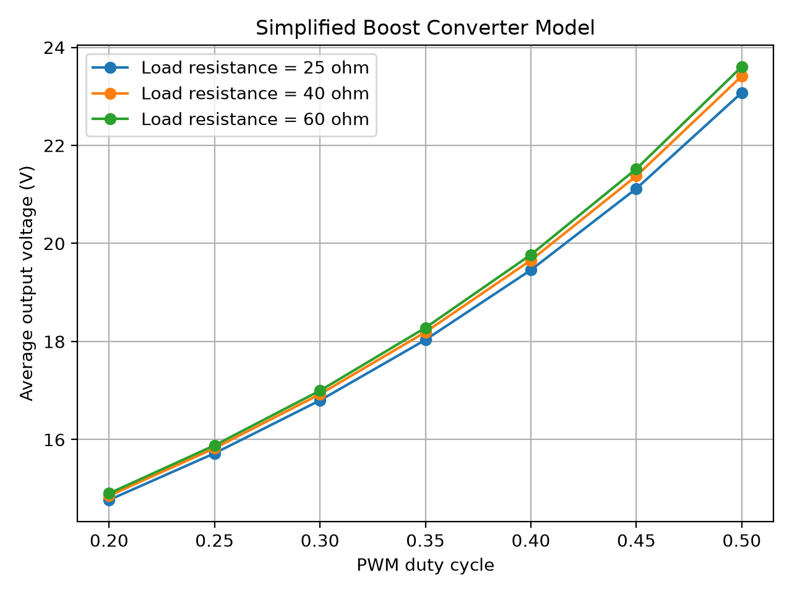
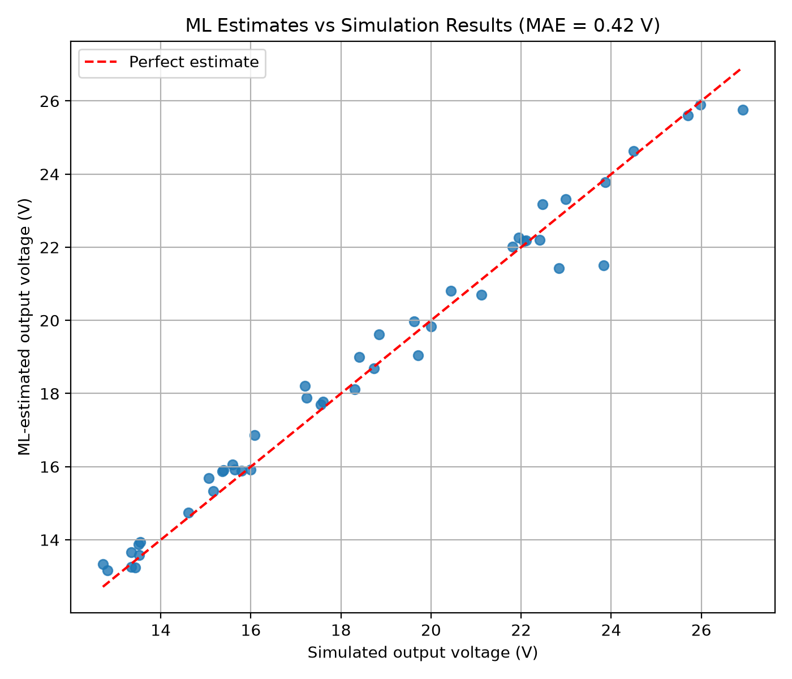
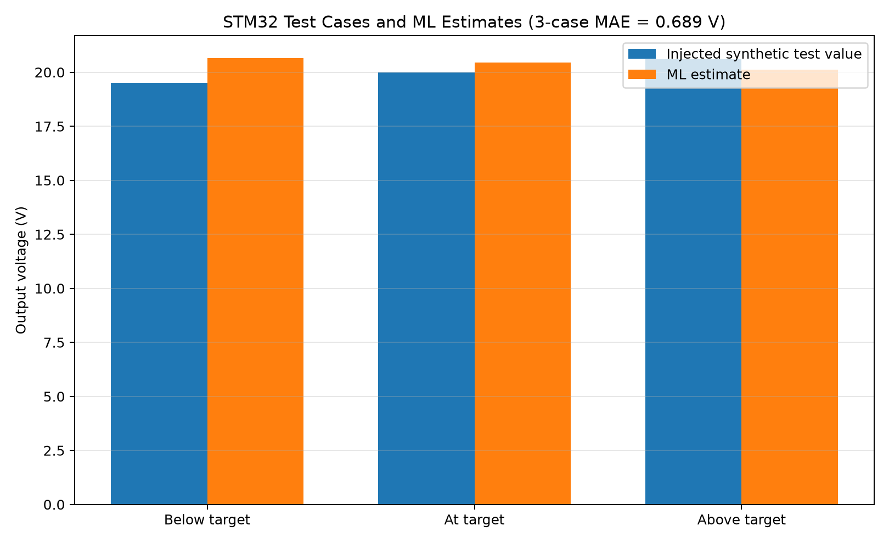

# BoostConverterML

Boost converter simulation, machine learning voltage estimation, and STM32F407 controller testing.

Course: AT00CT58 Tehoelektroniikan perusteet, LAB University of Applied Sciences.

## Overview

This project explores how duty cycle affects boost converter output voltage.

Python generates synthetic converter data. A Random Forest model estimates the simulated output voltage. STM32F407 firmware receives supplied test values and calculates duty commands and LED status.

The simulation and embedded controller tests are separate demonstrations. They do not form an automated closed control loop.

## Hardware and tools

- STM32F407G-DISC1 Discovery board

- Integrated ST-LINK debugger/programmer

- Windows PowerShell

- Python, NumPy, Matplotlib, and scikit-learn

- Arm GNU Toolchain

- GNU Make

- STM32CubeProgrammer CLI

## Python simulation

The simplified numerical model generates 180 synthetic examples.

Inputs are input voltage, duty cycle, and load resistance. The output is calculated average output voltage.

The model does not validate switching ripple or transient response.

## Machine learning results

The original Random Forest evaluation used 135 training examples and 45 held-out test examples.

| Metric | Reported result |

| --- | ---: |

| MAE | 0.416 V |

| RMSE | 0.592 V |

These results measure agreement with the simulation. They do not establish accuracy on a physical converter.

## STM32 controller tests

PowerShell writes synthetic input values into a RAM mailbox through ST-LINK SWD.

The firmware combines feedforward with proportional and integral correction. It returns a duty command limited to 20-50% and displays status using onboard LEDs.

Recorded results with a 12 V input and a 20 V target:

| Supplied output | Duty command | Status |

| --- | ---: | --- |

| 19.5 V | 41.5% | Below target, orange |

| 20.0 V | 40.5% | In range, green |

| 20.6 V | 39.2% | Above target, red |

The integral state persists between requests. Duty commands can depend on earlier requests.

The load field is present in the mailbox, but the current controller calculation does not use it.

Matching request and response sequence numbers confirm that the firmware processed each request.

## Controller and ML comparison

The comparison script fits another Random Forest using all 180 simulated examples. It predicts voltage using each duty command returned by the STM32.

| Case | Injected value | ML estimate |

| --- | ---: | ---: |

| Below target | 19.5 V | 20.651 V |

| At target | 20.0 V | 20.448 V |

| Above target | 20.6 V | 20.132 V |

The injected values are controller test inputs. ML predictions correspond to the returned duty commands. Their average absolute difference of approximately 0.689 V is illustrative. It is not an independent ML accuracy metric or a measure of closed-loop performance.

## Main files

| File | Purpose |

| --- | --- |

| simulate_boost.py | Generate synthetic data and the duty-sweep plot |

| train_ml.py | Train and evaluate the original ML model |

| compare_controller_ml.py | Combine controller results with ML estimates |

| plot_controller_ml.py | Plot the illustrative comparison |

| requirements.txt | Record Python package versions |

| firmware/Src/main.c | Embedded controller entry point |

| firmware/run_controller_tests.ps1 | Run controller cases and export results |

Some firmware support files remain from the earlier MotionSense project used as the starting point.

## Running the Python work

The recorded environment used Python 3.15.0.

From the project root in PowerShell, create a virtual environment and install dependencies:

    python -m venv .venv

    \& ".\\.venv\\Scripts\\python.exe" -m pip install -r .\\requirements.txt

Run the simulation and original ML evaluation:

    \& ".\\.venv\\Scripts\\python.exe" .\\simulate_boost.py

    \& ".\\.venv\\Scripts\\python.exe" .\\train_ml.py

After controller test results are available:

    \& ".\\.venv\\Scripts\\python.exe" .\\compare_controller_ml.py

    \& ".\\.venv\\Scripts\\python.exe" .\\plot_controller_ml.py

## Building the firmware

Make the Arm GNU Toolchain and GNU Make available in PATH.

From the project root:

    Set-Location .\\firmware

    New-Item -ItemType Directory -Path .\\build -Force | Out-Null

    make

The inherited build target is named stm32_spi_lis3dsh.

Connect the board through ST-LINK. Set the path for your own STM32CubeProgrammer installation:

    $programmerCli = "C:\\path\\to\\STM32_Programmer_CLI.exe"

Program the board:

    \& $programmerCli -c port=SWD mode=UR -w .\\build\\stm32_spi_lis3dsh.elf -v -rst

Programming replaces the firmware currently running on the board.

Run the controller cases from the firmware folder:

    .\\run_controller_tests.ps1 -ProgrammerCli $programmerCli

The script saves controller_test_results.csv.

The current script assumes the mailbox starts at 0x20000000. Check the symbol address after changing or rebuilding firmware:

    arm-none-eabi-nm -n .\\build\\stm32_spi_lis3dsh.elf | Select-String "boost_exchange"

Update the script if the mailbox address changes.

## Scope and limitations

- Converter data is synthetic.

- The STM32 receives values written into RAM.

- No physical boost converter or voltage sensor is connected.

- The duty command is a numerical result, not a physical gate-drive signal.

- ML runs on the computer.

- SWD communication does not demonstrate real-time converter control.

- LED status is an indication, not validated protection.

- The project is an educational prototype.

Physical power electronics work requires an authorised and supervised environment, following the course instructions.

## Future work

- Automate communication between a dynamic simulation and the controller.

- Compare ML with an analytical baseline on the same held-out cases.

- Evaluate more input and load conditions.

## References

- AT00CT58 course materials

- STMicroelectronics board information:

  https://www.st.com/en/evaluation-tools/stm32f4discovery.html

- Texas Instruments, Basic Calculation of a Boost Converter's Power Stage:

  https://www.ti.com/lit/an/slva372d/slva372d.pdf

